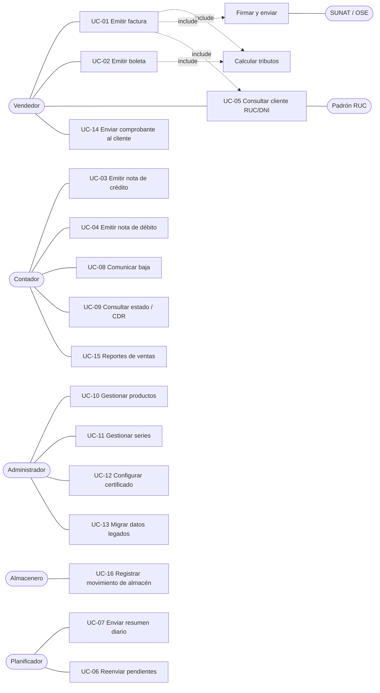

# 01 — Casos de uso

Fuente: funcionalidades habituales de los emisores electrónicos del mercado peruano (Nubefact,
SEE-SOL de SUNAT) y necesidades propias de una distribuidora de abarrotes.
A futuro se contrastará este catálogo con un usuario DEMO de Nubefact.

## 1. Actores

| Actor | Descripción |
|---|---|
| **Vendedor / Cajero** | Emite boletas y facturas desde Windows (caja) o Android (venta en ruta). |
| **Administrador** | Configura empresa, series, productos, usuarios y certificado digital. |
| **Contador** | Consulta, anula, emite notas, descarga XML/CDR, exporta reportes. |
| **Almacenero** | Registra ingresos y salidas (continuidad del legado). |
| **Cliente final** | Recibe el comprobante (PDF + XML) por correo / WhatsApp. |
| **SUNAT / OSE** | Sistema externo que valida y devuelve el CDR. |
| **Padrón RUC** | Fuente externa para consultar estado y condición del contribuyente. |
| **Planificador (sistema)** | Tareas automáticas: resumen diario, reintentos, consulta de estado. |

## 2. Diagrama general

## 3. Catálogo de casos de uso

Prioridad MoSCoW: **M** = Must, **S** = Should, **C** = Could, **W** = Won't (esta versión).

| ID | Caso de uso | Actor | Prioridad | Spec |
|---|---|---|---|---|
| UC-01 | Emitir factura electrónica | Vendedor | M | SPEC-001, 003, 004, 005, 006, 007 |
| UC-02 | Emitir boleta de venta electrónica | Vendedor | M | SPEC-001, 003, 005, 006 |
| UC-03 | Emitir nota de crédito (anulación, descuento, devolución) | Contador | M | SPEC-002 |
| UC-04 | Emitir nota de débito (intereses, penalidades, aumento de valor) | Contador | M | SPEC-002 |
| UC-05 | Consultar / validar cliente por RUC o DNI | Vendedor | M | SPEC-004 |
| UC-06 | Reenviar comprobantes pendientes o con error de conexión | Planificador | M | SPEC-007 |
| UC-07 | Enviar resumen diario de boletas | Planificador | M | SPEC-008 |
| UC-08 | Comunicar baja de comprobantes | Contador | M | SPEC-008 |
| UC-09 | Consultar estado y descargar XML / CDR / PDF | Contador | M | SPEC-007 |
| UC-10 | Gestionar productos (afectación IGV, ISC, ICBPER, unidad) | Administrador | M | SPEC-003, 010, 011 |
| UC-11 | Gestionar series por establecimiento y tipo de documento | Administrador | M | SPEC-005 |
| UC-12 | Configurar certificado digital y credenciales SOL / OSE | Administrador | M | SPEC-006, 007 |
| UC-13 | Migrar datos históricos del sistema legado | Administrador | M | SPEC-009 |
| UC-14 | Enviar comprobante al cliente (correo / enlace) | Vendedor | S | SPEC-001 |
| UC-15 | Reporte de ventas y registro de ventas | Contador | S | SPEC-001 |
| UC-16 | Registrar movimiento de almacén (ingreso / salida) | Almacenero | M | SPEC-010 |
| UC-17 | Emitir con forma de pago al crédito (cuotas) | Vendedor | S | SPEC-001 |
| UC-18 | Operaciones gratuitas (bonificaciones / muestras) | Vendedor | S | SPEC-003 |
| UC-19 | Venta en ruta sin conexión (Android) y sincronización | Vendedor | S | SPEC-012 |
| UC-20 | Multimoneda (USD) con tipo de cambio | Vendedor | C | SPEC-001 |
| UC-21 | Guía de remisión electrónica | Almacenero | C | — (fase 2) |
| UC-22 | Detracciones, retenciones y percepciones | Contador | W | — (fase 2) |
| UC-23 | Anticipos y exportaciones | Contador | W | — (fase 2) |

## 4. Escenarios principales (resumen)

### UC-01 Emitir factura
1. El vendedor ingresa RUC del cliente → el sistema valida dígito verificador y consulta el padrón (UC-05).
2. Agrega ítems; el sistema propone afectación IGV / ISC / ICBPER desde el producto.
3. El sistema calcula tributos y totales (SPEC-003) y muestra la vista previa.
4. El vendedor confirma; el sistema reserva el correlativo (SPEC-005).
5. Se genera el XML UBL 2.1, se firma (SPEC-006) y se envía al OSE / SUNAT (SPEC-007).
6. Se guarda el CDR y se actualiza el estado: `ACEPTADO`, `OBSERVADO` o `RECHAZADO`.
7. Se descuenta stock (SPEC-010) y se ofrece enviar el PDF al cliente (UC-14).

**Alternativos:** RUC con estado *BAJA* o condición *NO HABIDO* → advertencia (bloqueo configurable);
sin conexión → estado `PENDIENTE_ENVIO`, se reintenta (UC-06); rechazo → el correlativo **no se reutiliza**,
se corrige emitiendo un nuevo comprobante.

### UC-02 Emitir boleta
Igual que UC-01, pero el cliente puede ser anónimo si el total no supera el umbral vigente
(S/ 700); si lo supera, el DNI/documento es obligatorio. La boleta se informa por envío
individual o por resumen diario (UC-07).

## 5. Problemas frecuentes en facturación electrónica y requisito derivado

| Problema | Requisito derivado |
|---|---|
| Rechazo por redondeo de IGV | Cálculo decimal exacto y tolerancia ±1.00 documentada (SPEC-003). |
| Caída de SUNAT / OSE | Estado `PENDIENTE_ENVIO` + reintento automático (SPEC-007). |
| Factura a un RUC dado de baja | Consulta de padrón con caché (SPEC-004). |
| Incertidumbre sobre si el comprobante fue aceptado | Estados visibles y CDR descargable (UC-09). |
| Venta en ruta sin internet | Cola offline en Android (UC-19, SPEC-012). |
| Numeración duplicada o con saltos | Correlativos no reutilizables; anulación vía baja o NC (SPEC-005, SPEC-008). |
