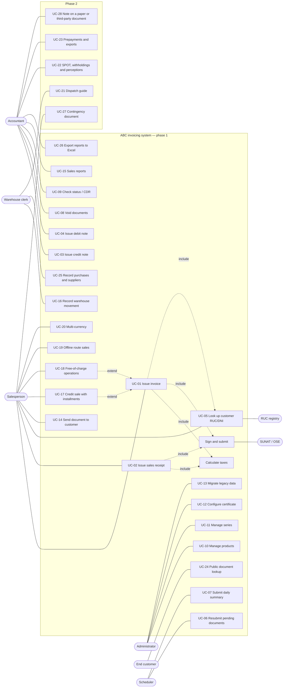

# 01 — Use cases

Sources:

1. Features published by **Nubefact** on its website (section 6).
2. Issuance problems reported by electronic invoicing providers (section 5).
3. Specific needs of a grocery distributor (exam case).
4. Verification against Nubefact's official help center and public JSON integration manual (section 7).

## 1. Actors

| Actor | Description |
|---|---|
| **Salesperson / Cashier** | Issues sales receipts and invoices from Windows (point of sale) or Android (route sales). |
| **Administrator** | Configures company, series, products, users and the digital certificate. |
| **Accountant** | Looks up, voids, issues notes, downloads XML/CDR, exports reports. |
| **Warehouse clerk** | Records inbound and outbound movements (continuity with the legacy system). |
| **End customer** | Receives the document (PDF + XML) by email and can look it up on the web (UC-24). |
| **SUNAT / OSE** | External system that validates and returns the CDR. |
| **RUC registry** | External source to check the taxpayer's status and condition. |
| **Scheduler (system)** | Automatic tasks: daily summary, retries, status lookups. |

## 2. Overview diagram

## 3. Use case catalog

MoSCoW priority: **M** = Must, **S** = Should, **C** = Could, **W** = Won't (this version).

| ID | Use case | Actor | Priority | Spec |
|---|---|---|---|---|
| UC-01 | Issue an electronic invoice | Salesperson | M | SPEC-001, 003, 004, 005, 006, 007 |
| UC-02 | Issue an electronic sales receipt | Salesperson | M | SPEC-001, 003, 005, 006 |
| UC-03 | Issue a credit note (cancellation, discount, return) | Accountant | M | SPEC-002 |
| UC-04 | Issue a debit note (interest, penalties, value increase) | Accountant | M | SPEC-002 |
| UC-05 | Look up / validate a customer by RUC or DNI | Salesperson | M | SPEC-004 |
| UC-06 | Resubmit pending documents or those with connection errors | Scheduler | M | SPEC-007 |
| UC-07 | Submit the daily summary of sales receipts | Scheduler | M | SPEC-008 |
| UC-08 | Void documents (voiding communication) | Accountant | M | SPEC-008 |
| UC-09 | Check status and download XML / CDR / PDF | Accountant | M | SPEC-007 |
| UC-10 | Manage products (IGV affectation, ISC, ICBPER, unit) | Administrator | M | SPEC-003, 010, 011 |
| UC-11 | Manage series per establishment and document type | Administrator | M | SPEC-005 |
| UC-12 | Configure the digital certificate and SOL / OSE credentials | Administrator | M | SPEC-006, 007 |
| UC-13 | Migrate historical data from the legacy system | Administrator | M | SPEC-009 |
| UC-14 | Send the document to the customer (email / link) | Salesperson | S | SPEC-001 |
| UC-15 | Sales report and sales register | Accountant | S | SPEC-001 |
| UC-16 | Record a warehouse movement (inbound / outbound) | Warehouse clerk | M | SPEC-010 |
| UC-17 | Issue with credit payment terms (installments) | Salesperson | S | SPEC-001 |
| UC-18 | Free-of-charge operations (bonuses / samples) | Salesperson | S | SPEC-003 |
| UC-19 | Offline route sales (Android) and synchronization | Salesperson | S | SPEC-012 |
| UC-20 | Multi-currency (USD) with exchange rate | Salesperson | C | SPEC-001 |
| UC-21 | Electronic dispatch guide | Warehouse clerk | C | — (phase 2) |
| UC-22 | SPOT withholdings (*detracciones*), withholdings and perceptions | Accountant | W | — (phase 2) |
| UC-23 | Prepayments and exports | Accountant | W | — (phase 2) |
| UC-24 | Public document lookup by the customer (web, by RUC/series/number) | End customer | S | SPEC-001 |
| UC-25 | Record purchases and suppliers (source of warehouse inbound movements) | Warehouse clerk | C | SPEC-010 |
| UC-26 | Export reports to Excel | Accountant | S | SPEC-001 |
| UC-27 | Issue a contingency document (when electronic issuance is impossible for reasons beyond the issuer's control) | Salesperson | C | — (phase 2) |
| UC-28 | Issue a credit/debit note on a paper document or one issued by another system | Accountant | C | — (phase 2) |

## 4. Main scenarios (summary)

### UC-01 Issue invoice
1. The salesperson enters the customer RUC → the system validates the check digit and queries the registry (UC-05).
2. Adds line items; the system proposes the IGV affectation / ISC / ICBPER from the product.
3. The system calculates taxes and totals (SPEC-003) and shows a preview.
4. The salesperson confirms; the system reserves the sequence number (SPEC-005).
5. The UBL 2.1 XML is built, signed (SPEC-006) and submitted to the OSE / SUNAT (SPEC-007).
6. The CDR is stored and the status is updated: `ACCEPTED`, `OBSERVED` or `REJECTED`.
7. Stock is decreased (SPEC-010) and the system offers to email the PDF to the customer (UC-14).

**Alternative flows:** RUC with status *BAJA* (deregistered) or condition *NO HABIDO* (not located) → warning
(blocking is configurable); no connection → status `PENDING_SUBMISSION`, retried later (UC-06);
rejection → the sequence number is **never reused**; it is fixed by issuing a new document.

### UC-02 Issue sales receipt
Same as UC-01, but the customer may be anonymous if the total does not exceed the current threshold
(S/ 700); above it, the DNI/document is mandatory. The sales receipt is reported individually or
through the daily summary (UC-07).

## 5. Frequent electronic invoicing problems and derived requirement

| Reported problem | Source | Derived requirement |
|---|---|---|
| Mistyped RUC or incomplete legal name invalidates the invoice | [F2], [F3] | Modulus 11 validation + registry lookup (SPEC-004). |
| Wrong IGV rate; mismatch between subtotal and total | [F2], [F3] | Single server-side calculation, exact decimals, ±1.00 tolerance (SPEC-003). |
| Outdated exchange rate in foreign currency | [F3] | `exchangeRate` mandatory if currency ≠ PEN (SPEC-001 R-05). |
| Slow SUNAT server: the issuer resubmits and duplicates the sequence number (error 1033) | [F3] | `Idempotency-Key` + status lookup before resubmitting (SPEC-005 R-06, SPEC-007 R-06). |
| Invalid signature or expired certificate | [F3] | Certificate validation before signing (SPEC-006 AC-3). |
| Invalid series or numbering; the rejected number becomes unusable | [F2] | Registered series; sequence number never reused (SPEC-005 R-02, R-05). |
| Submission after the deadline | [F2] | Retries and an alert before the deadline (SPEC-007 R-05). |
| Invalid SUNAT product code (observation 4332) | [F3] | UNSPSC code on the product (SPEC-010, matrix T-48). |
| Route sales without internet | Exam case | Offline queue on Android (UC-19, SPEC-012). |

## 6. Comparison with Nubefact (published features)

| Nubefact feature [F1] | Use case | Result |
|---|---|---|
| Invoices, sales receipts, credit and debit notes | UC-01 … UC-04 | Covered |
| Voiding and reversals | UC-08 | Covered (voiding); withholding/perception reversals in phase 2 |
| Dispatch guides (sender and carrier) | UC-21 | Phase 2 |
| Withholding and perception receipts | UC-22 | Phase 2 |
| Unlimited establishments and users | UC-11, actors | Covered (series per establishment, roles) |
| Printed representation A4, A5 and ticket, with logo | UC-09 | Covered (A4 and ticket); A5 to be evaluated |
| Sales, purchases, products, customers, suppliers module | UC-10, UC-16, **UC-25** | **Added** UC-25 (purchases and suppliers) |
| Excel reports | **UC-26** | **Added** |
| Web publication of the document / "Find your document" | **UC-24** | **Added** |
| REST API to integrate other systems | `openapi.yaml` | Covered |
| Digital certificate included | UC-12 | Covered (certificate configuration) |
| Responsive design (PC, tablet, phone) | SPEC-012 | Covered (Windows + Android) |
| System status page | UC-06 | Partially covered (`PENDING_SUBMISSION` status) |

Use cases UC-13 (legacy migration), UC-16 (warehouse) and UC-19 (offline route sales) do not
appear in Nubefact: they come from ABC's specific case.

About user opinions: the public sources found are scarce and come from provider blogs; the only
Nubefact-specific review highlights its affordable price and reasonable support times [F4]. That is
why the catalog was verified against Nubefact's official documentation (section 7).

## 7. Verification against Nubefact's public documentation

Registering a Nubefact account requires a real RUC, so the verification was done with its official
help center [F5], which documents each screen of the web system, and its public JSON integration
manual [F6], which lists every field the system accepts. Result: **Yes** (confirmed),
**Partial** (partly confirmed) or **Not verified**.

| # | What was checked | Result | Evidence in Nubefact | Use case / spec |
|---|---|---|---|---|
| 1 | Main menu | Yes | Documents, Voiding, Daily summaries, Purchases, Entities (customers and suppliers), Catalog, Categories, Reports, Guides, Withholdings / Perceptions, Contingency, API integration, Settings (company, users, establishments and series, format, bank accounts) [F5]. | Catalog in section 3 |
| 2 | Invoice form | Yes | Screen: entity, operation type, items, IGV type, with a **draft** option [F5]. Full field list in the JSON manual [F6]. | UC-01 · status `DRAFT` |
| 3 | RUC validation and autocomplete | Yes | When a RUC is entered it offers to "import the data from SUNAT" [F5]. | UC-05 · SPEC-004 |
| 4 | Sales receipt with a "various" customer and S/ 700 threshold | Yes | `cliente_tipo_de_documento` = `-` "VARIOS - VENTAS MENORES A S/.700.00 Y OTROS" [F6]. | UC-02 · SPEC-001 R-04 |
| 5 | Items: IGV affectation, ISC, ICBPER, unit | Yes | `tipo_de_igv` (20 affectation types), `tipo_de_isc` (1, 2, 3 = catalog 08 systems), `isc`, `impuesto_bolsas` (ICBPER per line), configurable units [F5][F6]. | UC-10 · SPEC-003 |
| 6 | Credit payment terms with installments | Yes | `venta_al_credito` with numbered installments (`cuota`) [F6]. | UC-17 · SPEC-001 R-06 |
| 7 | Credit note | Yes | From Documents or from the original document's Options; also on **paper** documents or documents from **another system** [F5]. `tipo_de_nota_de_credito`: the 13 catalog 09 types [F6]. | UC-03 · **UC-28** |
| 8 | Debit note | Yes | Same flow as the credit note [F5]. `tipo_de_nota_de_debito`: late-payment interest, value increase, penalties, IVAP and export adjustments (catalog 10) [F6]. | UC-04 · SPEC-002 |
| 9 | Voiding communication | Yes | Requires an **accepted** CDR; **7-day** deadline from issuance; from the document or the Voiding panel; after the deadline, a credit note is issued [F5]. | UC-08 · SPEC-008 R-04 |
| 10 | Daily summary of sales receipts | Yes | Generated **automatically every 24 hours**; SUNAT status shown with colors [F5]. | UC-07 · SPEC-008 R-02 |
| 11 | Statuses and XML / CDR / PDF download | Yes | Response with `aceptada_por_sunat`, `enlace_del_pdf`, `enlace_del_xml`, `enlace_del_cdr` [F6]; SUNAT status visible in the web system [F5]. | UC-09 · SPEC-007 |
| 12 | Sending to the customer | Yes | **Email** only, to the registered address or another, and only once SUNAT has accepted the document [F5]; `enviar_automaticamente_al_cliente` [F6]. | UC-14 |
| 13 | Series and establishments | Yes | Settings → Establishments and series: SUNAT establishment code (`0000` if there is only one), ubigeo, responsible user; series F (invoices and their notes), B (sales receipts and their notes), T and V (guides) [F5]. | UC-11 · SPEC-005 R-01 · matrix T-15 |
| 14 | Reports | Yes | Excel by date range, per **items** or per **documents**, for one establishment or all [F5]. | UC-15 · UC-26 |
| 15 | Products, customers, purchases and suppliers | Yes | Catalog with categories; Entities (customers and suppliers); Purchases → Add purchase, exportable to Excel. Stock control is not mentioned [F5]. | UC-10 · UC-25 |
| 16 | Contingency | Yes | Contingency document when electronic issuance is impossible for reasons beyond the issuer's control [F5]. | **UC-27** |

**Conclusions**

- All **16 points confirmed** with public documentation; none contradicts the catalog. New findings were added as **UC-27** and **UC-28**.
- Nubefact uses a `codigo_unico` field so that it controls duplicate generation [F6]: the same idea as our `Idempotency-Key` (SPEC-005 R-06).
- According to its documentation, Nubefact **does not control stock**: inventory integrated with sales (SPEC-010) and the legacy migration (SPEC-009) are ABC-specific needs.
- **Pending (optional):** a screen-by-screen walkthrough with a Nubefact DEMO account. It requires a RUC, which is not available; the instructor stated it is optional.

## 8. References

- [F1] Nubefact — official website and Nubefact Online: <https://www.nubefact.com>, <https://www.nubefact.com/nubefact-online>
- [F2] Nubefact — "¿Tu factura electrónica fue rechazada por SUNAT? Conoce los motivos y qué hacer": <https://www.nubefact.com/blog/facturacion-electronica/tu-factura-electronica-fue-rechazada-por-sunat-conoce-los-motivos-y-que-hacer>
- [F3] Frequent errors reported by providers: <https://bizlinks.com.pe/errores-frecuentes-en-la-facturacion-electronica-sunat/>, <https://acepta.com/pe/blog/errores-en-facturacion-electronica/>, <https://perusoftware.net.pe/blog/errores-sunat-codigos-significado-solucion>, <https://www.nubefact.com/codigos-error-sunat>
- [F4] kom.pe — "Cómo emitir boletas y facturas SUNAT desde WooCommerce": <https://kom.pe/como-emitir-boletas-y-facturas-sunat-desde-woocommerce/>
- [F5] Nubefact help center — NubeFact Web FAQ: <https://ayuda.nubefact.com/preguntas/nubefact-web>. Articles used: issue invoice, issue sales receipt, issue credit / debit note, when to issue a credit note, void an invoice, voiding deadlines, automatic daily summaries, establishments and series, product catalog, purchases, reports, sending to the customer and contingency.
- [F6] Nubefact — invoice, sales receipt and notes integration manual (JSON), linked from <https://www.nubefact.com/integracion>: <https://docs.google.com/document/d/1QWWSILBbjd4MDkJl7vCkL2RZvkPh0IC7Wa67BvoYIhA/edit>
