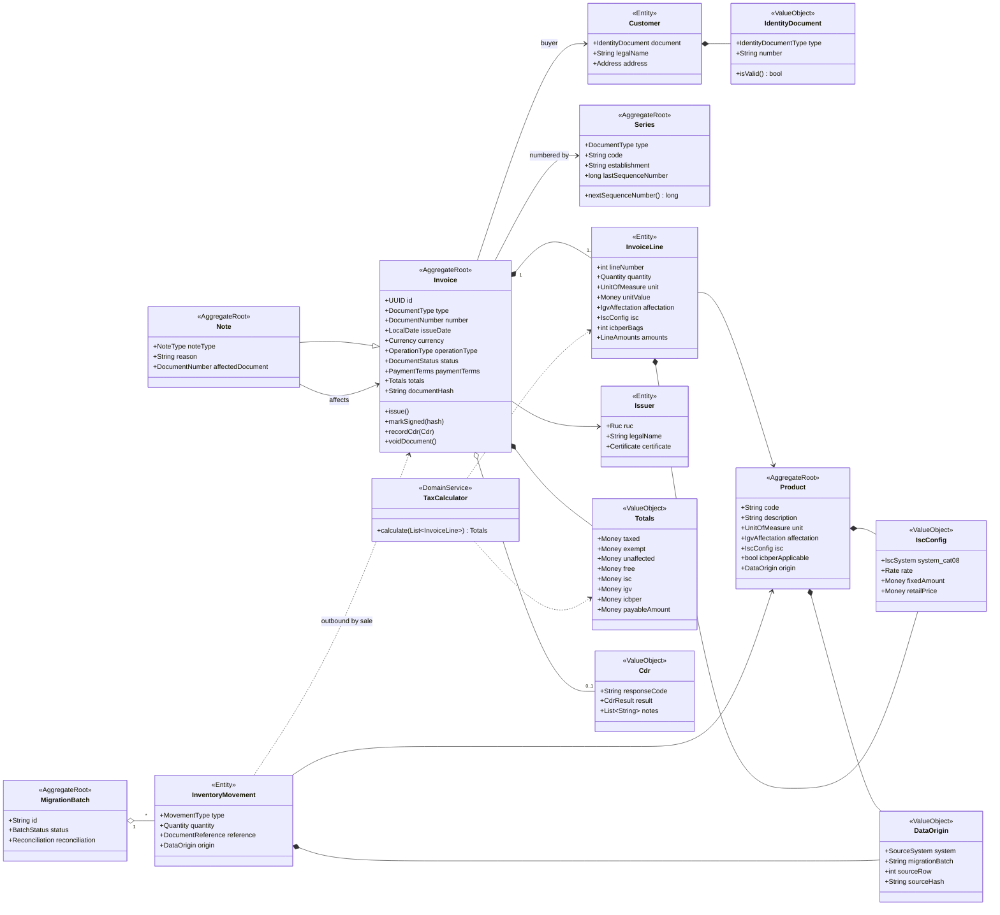
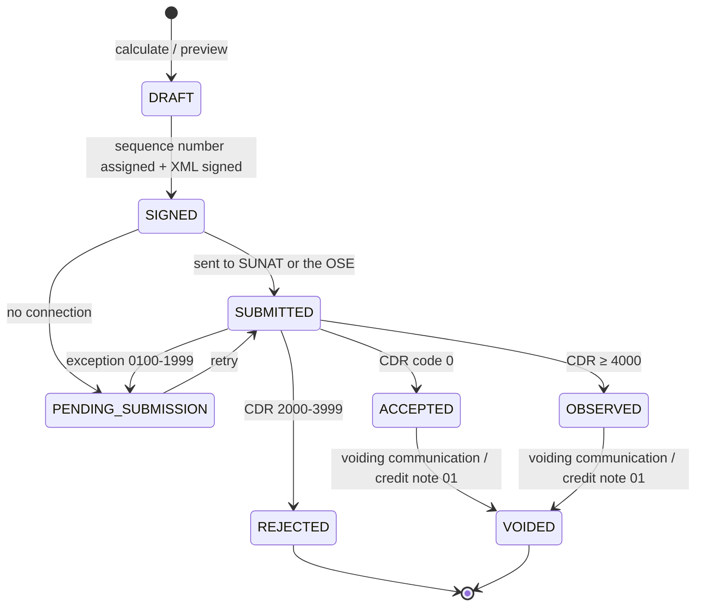

# 02 — Domain model and contracts

> Exam deliverable 1. The executable contracts are in [specs/schemas/](../specs/schemas/)
> (JSON Schema 2020-12) and the catalogs in [specs/catalogs/](../specs/catalogs/).

## 1. Bounded contexts

Each context will be a **module** of the monolith and, in the future, a microservice candidate.

| Context | Responsibility | Aggregates / entities | Specs |
|---|---|---|---|
| **Invoicing** | Issue and manage documents | `Invoice`, `InvoiceLine`, `Note`, `Series` | 001, 002, 005 |
| **Taxation** | Calculate IGV / ISC / ICBPER and totals | `TaxCalculator`, `TaxRule`, `TaxParameter` | 003 |
| **Identity** | Validate and look up customers | `Customer`, `IdentityDocument`, `Taxpayer` | 004 |
| **SUNAT integration** | UBL XML, signature, submission, CDR, summary, voiding | `ElectronicDocument`, `Submission`, `Cdr`, `Ticket` | 006, 007, 008 |
| **Inventory** | Products and warehouse movements | `Product`, `InventoryMovement` | 010 |
| **Migration** | Import the legacy data with traceability | `MigrationBatch`, `MigrationIssue` | 009 |
| **Catalogs** (shared) | SUNAT codes with effective periods | `Catalog`, `CatalogCode` | 011 |

## 2. Domain class diagram

## 3. Document lifecycle

## 4. Domain invariants (rules the model never allows to break)

| ID | Invariant | Aggregate |
|---|---|---|
| INV-01 | A document has at least one line. | Invoice |
| INV-02 | Invoice (01) ⇒ series starts with `F` and the customer has a valid RUC (type 6). | Invoice |
| INV-03 | Sales receipt (03) ⇒ series starts with `B`; if the amount exceeds the current threshold (S/ 700) the customer must be identified. | Invoice |
| INV-04 | `payableAmount = Σ saleValue + Σ ISC + Σ IGV + Σ ICBPER + charges − global discounts` (±1.00 rounding tolerance). | Invoice |
| INV-05 | The sequence number is unique per (RUC, type, series), consecutive and **never reused**, even if the document is rejected. | Series |
| INV-06 | An `ACCEPTED` document is immutable; it is only corrected with a note or voiding. | Invoice |
| INV-07 | Note ⇒ references an existing document from the same issuer with a compatible series prefix (F↔F, B↔B). | Note |
| INV-08 | ISC ⇒ the product declares its `system` (catalog 08) and the parameter that system requires. | Product / Line |
| INV-09 | All migrated data keeps its `DataOrigin` with the hash of the original row. | Movement / Product |
| INV-10 | Amounts are handled as exact decimals (`BigDecimal`), never `double`. | All |

## 5. Contract index (DTOs / schemas)

| Contract | File | Usage |
|---|---|---|
| Common types (Amount, Ruc, Series, catalog enums) | [common.schema.json](../specs/schemas/common.schema.json) | Reused by all |
| `IssueInvoiceRequest`, `Invoice`, `Totals`, `PaymentTerms` | [invoice.schema.json](../specs/schemas/invoice.schema.json) | SPEC-001 |
| `LineRequest`, `CalculatedLine` | [line.schema.json](../specs/schemas/line.schema.json) | SPEC-001, 002, 003 |
| `NoteDTO` | [note.schema.json](../specs/schemas/note.schema.json) | SPEC-002 |
| `CustomerDTO` | [customer.schema.json](../specs/schemas/customer.schema.json) | SPEC-004 |
| `CdrResponseDTO` | [cdr-response.schema.json](../specs/schemas/cdr-response.schema.json) | SPEC-007 |
| `VoidedDocumentsDTO` | [voided-documents.schema.json](../specs/schemas/voided-documents.schema.json) | SPEC-008 |
| `LegacyMovementDTO` (source) | [legacy-movement.schema.json](../specs/schemas/legacy-movement.schema.json) | SPEC-009 |
| `InventoryMovementDTO` (target) | [inventory-movement.schema.json](../specs/schemas/inventory-movement.schema.json) | SPEC-009, 010 |
| `ProductDTO`, `IscConfig` | [product.schema.json](../specs/schemas/product.schema.json) | SPEC-003, 010 |
| `SunatCatalogDTO` | [catalog.schema.json](../specs/schemas/catalog.schema.json) | SPEC-011 |
| `ErrorDTO` (problem+json) | [error.schema.json](../specs/schemas/error.schema.json) | Whole API |

Examples validated against the schemas: [specs/schemas/examples/](../specs/schemas/examples/).

### Contract design decisions

- **Amounts as decimal strings**: JSON `number` is parsed as `double` by many clients and causes
  rounding errors (e.g. `0.1 + 0.2`). It is a frequent cause of rejections due to IGV mismatches.
- **Request ≠ response**: the client sends only the input data (`LineRequest`); the amounts are
  **always** calculated by the domain (`CalculatedLine`). The calculation is not duplicated on
  Windows and Android, and totals sent by the client are never trusted.
- **English names, explicit UBL mapping**: the DTO uses English identifiers following common
  practice; Peruvian tax terms (RUC, IGV, ISC, ICBPER) keep their official acronyms. The translation
  to UBL XPath lives in a single adapter and is documented in the
  [traceability matrix](05-traceability-matrix.md).
