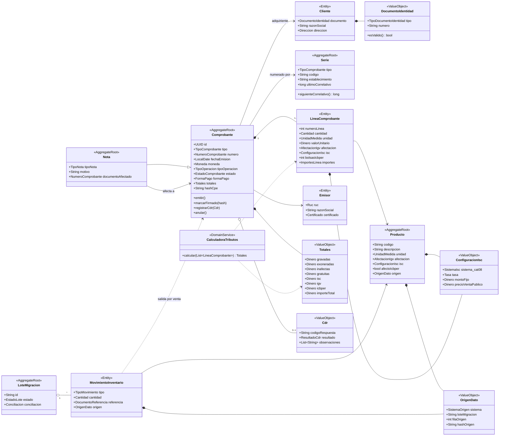
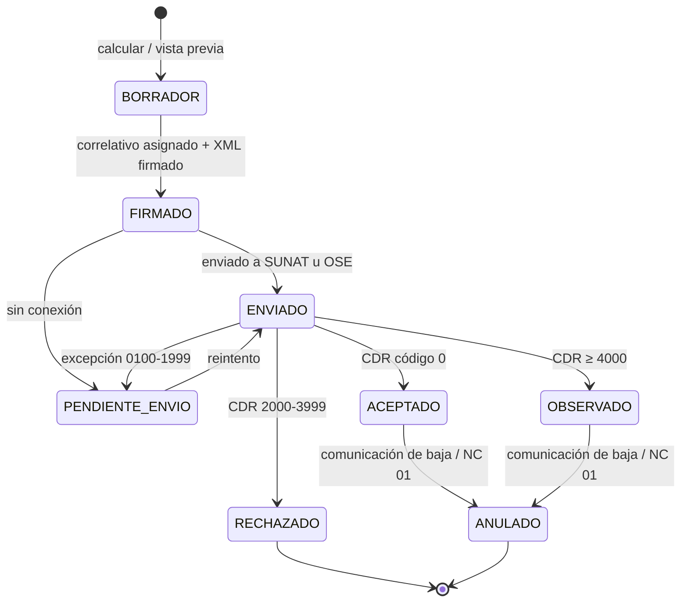

# 02 — Modelo de dominio y contratos

> Entregable 1 del examen. Los contratos ejecutables están en [specs/schemas/](../specs/schemas/)
> (JSON Schema 2020-12) y los catálogos en [specs/catalogos/](../specs/catalogos/).

## 1. Contextos delimitados (bounded contexts)

Cada contexto será un **módulo** del monolito y, en el futuro, un candidato a microservicio.

| Contexto | Responsabilidad | Agregados / entidades | Specs |
|---|---|---|---|
| **Facturación** | Emitir y gestionar comprobantes | `Comprobante`, `LineaComprobante`, `Nota`, `Serie` | 001, 002, 005 |
| **Tributación** | Calcular IGV / ISC / ICBPER y totales | `CalculadoraTributos`, `ReglaTributaria`, `ParametroTributario` | 003 |
| **Identidad** | Validar y consultar clientes | `Cliente`, `DocumentoIdentidad`, `Contribuyente` | 004 |
| **Integración SUNAT** | XML UBL, firma, envío, CDR, resumen, baja | `DocumentoElectronico`, `Envio`, `Cdr`, `Ticket` | 006, 007, 008 |
| **Inventario** | Productos y movimientos de almacén | `Producto`, `MovimientoInventario` | 010 |
| **Migración** | Importar el legado con trazabilidad | `LoteMigracion`, `IncidenciaMigracion` | 009 |
| **Catálogos** (compartido) | Códigos SUNAT con vigencia | `Catalogo`, `CodigoCatalogo` | 011 |

## 2. Diagrama de clases del dominio

## 3. Ciclo de vida del comprobante

## 4. Invariantes del dominio (reglas que el modelo nunca permite romper)

| ID | Invariante | Agregado |
|---|---|---|
| INV-01 | Un comprobante tiene al menos una línea. | Comprobante |
| INV-02 | Factura (01) ⇒ serie empieza con `F` y cliente con RUC (tipo 6) válido. | Comprobante |
| INV-03 | Boleta (03) ⇒ serie empieza con `B`; si el importe supera el umbral vigente (S/ 700) el cliente debe identificarse. | Comprobante |
| INV-04 | `importeTotal = Σ valorVenta + Σ ISC + Σ IGV + Σ ICBPER + cargos − descuentos globales` (tolerancia ±1.00 por redondeo). | Comprobante |
| INV-05 | El correlativo es único por (RUC, tipo, serie), consecutivo y **nunca se reutiliza**, aun si el comprobante es rechazado. | Serie |
| INV-06 | Un comprobante `ACEPTADO` es inmutable; solo se corrige con nota o baja. | Comprobante |
| INV-07 | Nota ⇒ referencia un comprobante existente, del mismo emisor y con prefijo de serie compatible (F↔F, B↔B). | Nota |
| INV-08 | ISC ⇒ el producto declara `sistema` (catálogo 08) y el parámetro que ese sistema exige. | Producto / Línea |
| INV-09 | Todo dato migrado conserva `OrigenDato` con hash de la fila original. | Movimiento / Producto |
| INV-10 | Los montos se manejan como decimales exactos (`BigDecimal`), nunca `double`. | Todos |

## 5. Índice de contratos (DTOs / esquemas)

| Contrato | Archivo | Uso |
|---|---|---|
| Tipos comunes (Monto, Ruc, Serie, enums de catálogos) | [common.schema.json](../specs/schemas/common.schema.json) | Reutilizado por todos |
| `EmitirComprobanteRequest`, `Comprobante`, `Totales`, `FormaPago` | [comprobante.schema.json](../specs/schemas/comprobante.schema.json) | SPEC-001 |
| `LineaSolicitud`, `LineaCalculada` | [linea.schema.json](../specs/schemas/linea.schema.json) | SPEC-001, 002, 003 |
| `NotaDTO` | [nota.schema.json](../specs/schemas/nota.schema.json) | SPEC-002 |
| `ClienteDTO` | [cliente.schema.json](../specs/schemas/cliente.schema.json) | SPEC-004 |
| `RespuestaCdrDTO` | [respuesta-cdr.schema.json](../specs/schemas/respuesta-cdr.schema.json) | SPEC-007 |
| `ComunicacionBajaDTO` | [comunicacion-baja.schema.json](../specs/schemas/comunicacion-baja.schema.json) | SPEC-008 |
| `LegacyMovimientoDTO` (origen) | [legacy-movimiento.schema.json](../specs/schemas/legacy-movimiento.schema.json) | SPEC-009 |
| `MovimientoInventarioDTO` (destino) | [movimiento-inventario.schema.json](../specs/schemas/movimiento-inventario.schema.json) | SPEC-009, 010 |
| `ProductoDTO`, `ConfiguracionIsc` | [producto.schema.json](../specs/schemas/producto.schema.json) | SPEC-003, 010 |
| `CatalogoSunatDTO` | [catalogo.schema.json](../specs/schemas/catalogo.schema.json) | SPEC-011 |
| `ErrorDTO` (problem+json) | [error.schema.json](../specs/schemas/error.schema.json) | Toda la API |

Ejemplos validados contra los esquemas: [specs/schemas/examples/](../specs/schemas/examples/).

### Decisiones de diseño de los contratos

- **Montos como string decimal**: JSON `number` se interpreta como `double` en muchos clientes y
  provoca errores de redondeo (p.ej. `0.1 + 0.2`). Es una causa frecuente de rechazos por
  descuadre de IGV.
- **Solicitud ≠ respuesta**: el cliente envía solo los datos de entrada (`LineaSolicitud`); los
  importes los calcula **siempre** el dominio (`LineaCalculada`). Así el cálculo no se duplica en
  Windows y Android y no se confía en totales enviados por el cliente.
- **Nombres en español, mapeo explícito a UBL**: el DTO habla el lenguaje del negocio; la
  traducción a XPath UBL vive en un solo adaptador y está documentada en la
  [matriz de trazabilidad](05-matriz-trazabilidad.md).
