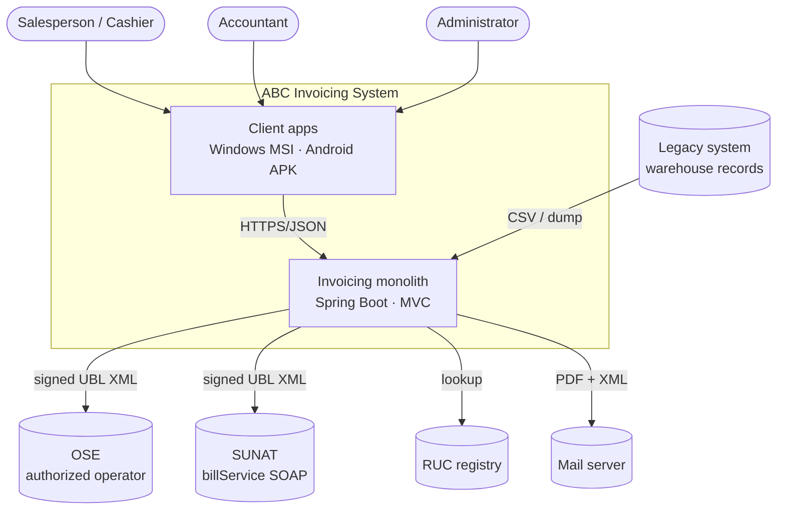
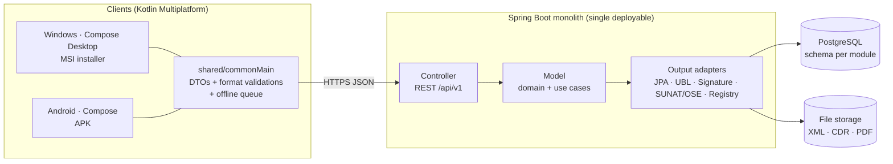
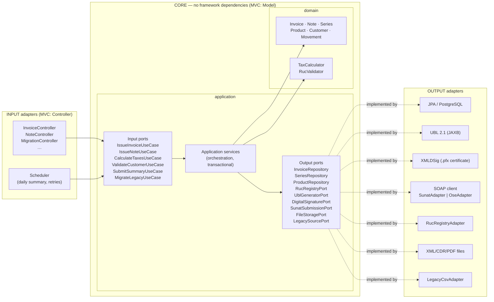
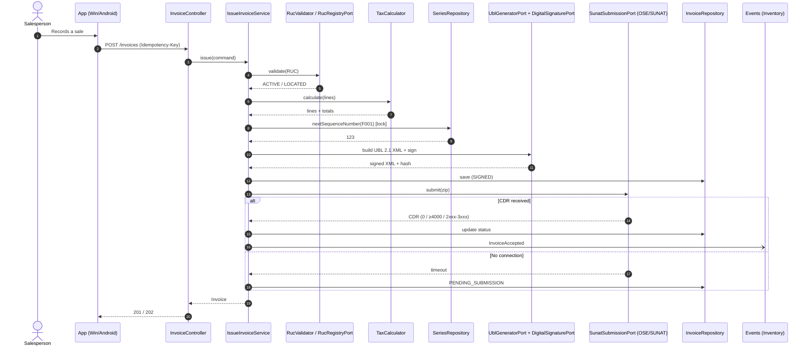
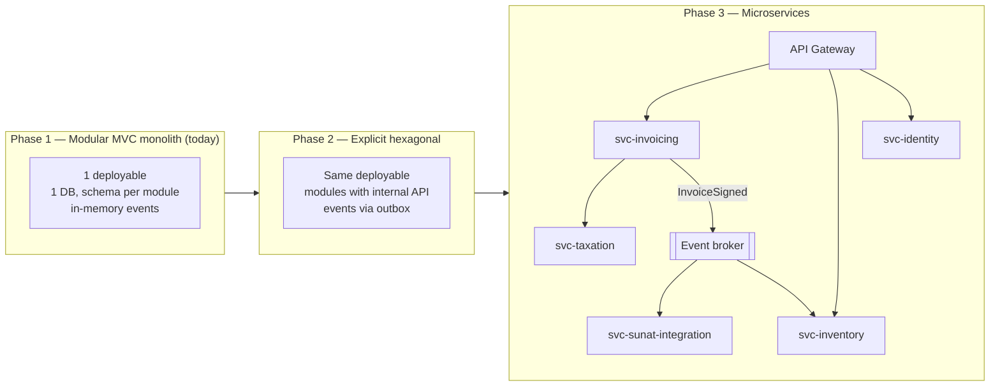

# 03 — Architecture: MVC today, Hexagonal tomorrow, microservices later

> Exam deliverable 2. Formal decisions in [docs/adr/](adr/).

## 1. Guiding principle

> **"MVC on the outside, ports and adapters on the inside."**

Management asks for an **MVC monolith** today and an **easy** migration to Hexagonal / microservices
tomorrow. To keep that migration cheap, MVC applies **only to the delivery layer** (controllers and
views). The MVC "Model" is **not** a layer of JPA entities coupled to the database: it is a **pure
domain core** that talks to the outside world only through **interfaces (ports)**.

| MVC letter | Where it lives | What it contains | Does it change when moving to Hexagonal? |
|---|---|---|---|
| **V**iew | Compose app (Windows/Android) + JSON | Screens, PDF, printed representation | No |
| **C**ontroller | `adapters/in/web` | REST controllers, DTO ↔ command mapping | No (renamed to "input adapter") |
| **M**odel | `domain` + `application` | Entities, rules, use cases, ports | No |
| (infrastructure) | `adapters/out/*` | JPA, XML signing, SUNAT/OSE SOAP client, RUC registry | No — they already are adapters |

That is why the migration means **reorganizing, not rewriting**.

## 2. Context view (C4 – level 1)



## 3. Container view — MVC monolith (initial state)



## 4. Component view — internal layers with a hexagonal outlook



**Dependency rule** (verifiable with ArchUnit during implementation):

1. `domain` depends on nothing (no Spring, no JPA, no JAXB).
2. `application` depends only on `domain`.
3. `adapters` depend on `application` and `domain`; **never the other way around**.
4. Context modules (`invoicing`, `taxation`, `inventory`…) communicate only through their public
   ports or through **domain events** (`InvoiceAccepted`, `InvoiceVoided`).

### Package structure (modular monolith)

```
com.abc.invoicing
├── invoicing/              ← context
│   ├── domain/             Invoice, Note, Series, events
│   ├── application/
│   │   ├── port/in/        IssueInvoiceUseCase …
│   │   ├── port/out/       InvoiceRepository, SeriesRepository …
│   │   └── service/
│   └── adapters/
│       ├── in/web/         InvoiceController (MVC)
│       └── out/persistence/
├── taxation/               TaxCalculator (pure domain, no output adapters)
├── identity/               RucValidator, RucRegistryPort
├── sunatintegration/       UblGenerator, DigitalSignature, SunatSubmission (SUNAT or OSE)
├── inventory/
├── migration/
└── catalogs/
```

## 5. Sequence: issue an invoice



## 6. Migration path to microservices



| Step | What is extracted first | Why |
|---|---|---|
| 1 | **SUNAT integration** | Highest latency and variability (timeouts, queues); scales differently. Already behind `SunatSubmissionPort`. |
| 2 | **Taxation** | Pure, stateless logic; changes often with regulations. |
| 3 | **Inventory** | Already communicates through events (`InvoiceAccepted`). |
| 4 | **Invoicing / Identity** | Transactional core; split last. |

**What never changes in any phase:** the contracts in [openapi.yaml](../specs/api/openapi.yaml) and the
JSON Schemas. The API Gateway routes the same paths to different services.

## 7. Quality attributes and tactics

| Attribute | Tactic |
|---|---|
| Availability when SUNAT/OSE is down | `PENDING_SUBMISSION` status, retries with backoff, persistent queue. |
| Numbering integrity | Pessimistic lock per series + `Idempotency-Key`. |
| Certificate security | Signing on the server only (ADR-003); `.pfx` in a secrets store. |
| Maintainability under regulatory changes | Parameters with effective periods (IGV, ICBPER, thresholds) and versioned catalogs (SPEC-011). |
| Portability | Kotlin Multiplatform: one codebase for Windows and Android (ADR-001). |
| Traceability / audit | `DataOrigin` + status change log (RS 234-2006). |
