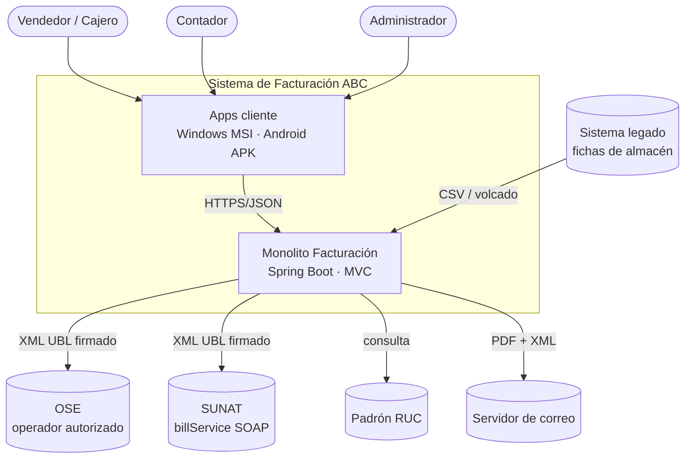
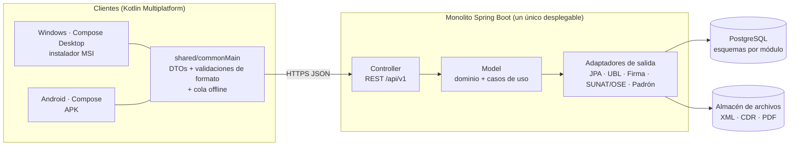
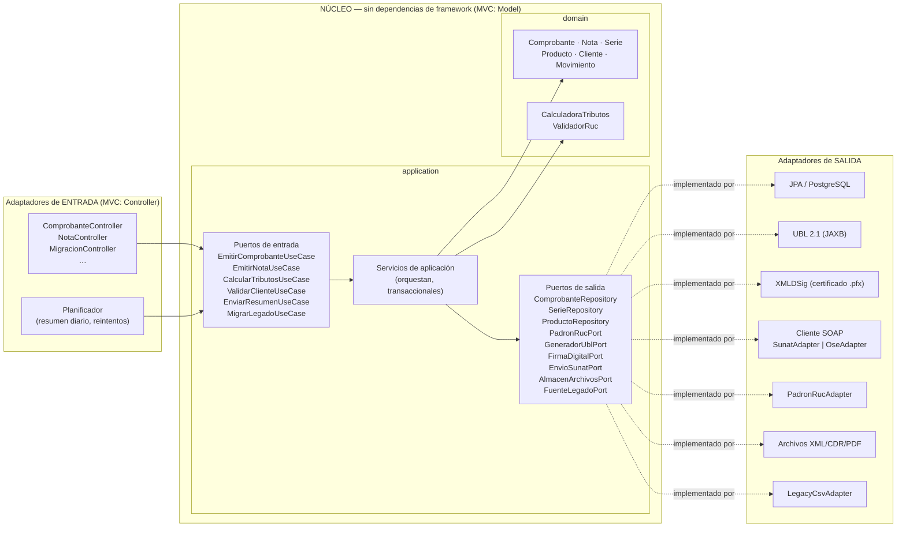
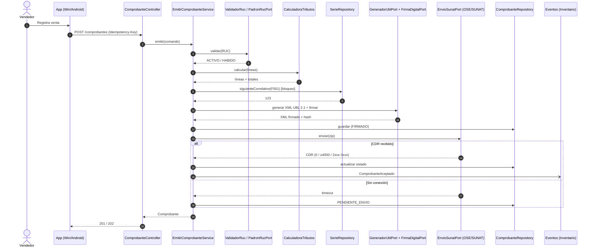
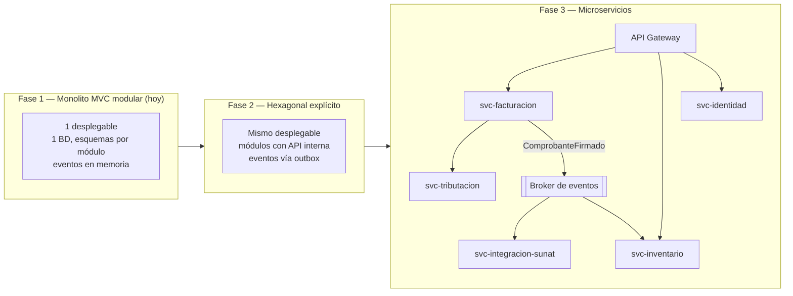

# 03 — Arquitectura: MVC hoy, Hexagonal mañana, microservicios después

> Entregable 2 del examen. Decisiones formales en [docs/adr/](adr/).

## 1. Principio rector

> **"MVC por fuera, puertos y adaptadores por dentro."**

La gerencia pide un **monolito MVC** hoy y una migración **fácil** a Hexagonal / microservicios
mañana. Para que esa migración sea barata, el MVC se aplica **solo en la capa de entrega**
(controladores y vistas). El "Modelo" del MVC **no es** una capa de entidades JPA acopladas a
la base de datos: es un **núcleo de dominio puro** que se comunica con el exterior solo a través de
**interfaces (puertos)**.

| Letra MVC | Dónde vive | Qué contiene | ¿Cambia al migrar a Hexagonal? |
|---|---|---|---|
| **V**ista | App Compose (Windows/Android) + JSON | Pantallas, PDF, representación impresa | No |
| **C**ontrolador | `adapters/in/web` | Controladores REST, mapeo DTO ↔ comando | No (se renombra a "adaptador de entrada") |
| **M**odelo | `domain` + `application` | Entidades, reglas, casos de uso, puertos | No |
| (infraestructura) | `adapters/out/*` | JPA, firma XML, cliente SOAP SUNAT/OSE, padrón RUC | No — ya son adaptadores |

Por eso la migración es **reorganizar, no reescribir**.

## 2. Vista de contexto (C4 – nivel 1)



## 3. Vista de contenedores — monolito MVC (estado inicial)



## 4. Vista de componentes — capas internas con visión hexagonal



**Regla de dependencias** (verificable con ArchUnit en la fase de implementación):

1. `domain` no depende de nada (ni Spring, ni JPA, ni JAXB).
2. `application` depende solo de `domain`.
3. `adapters` dependen de `application` y `domain`; **nunca al revés**.
4. Los módulos de contexto (`facturacion`, `tributacion`, `inventario`…) se comunican solo por
   sus puertos públicos o por **eventos de dominio** (`ComprobanteAceptado`, `ComprobanteAnulado`).

### Estructura de paquetes (monolito modular)

```
com.abc.facturacion
├── facturacion/            ← contexto
│   ├── domain/             Comprobante, Nota, Serie, eventos
│   ├── application/
│   │   ├── port/in/        EmitirComprobanteUseCase …
│   │   ├── port/out/       ComprobanteRepository, SerieRepository …
│   │   └── service/
│   └── adapters/
│       ├── in/web/         ComprobanteController (MVC)
│       └── out/persistence/
├── tributacion/            CalculadoraTributos (dominio puro, sin adaptadores de salida)
├── identidad/              ValidadorRuc, PadronRucPort
├── integracionsunat/       GeneradorUbl, FirmaDigital, EnvioSunat (SUNAT u OSE)
├── inventario/
├── migracion/
└── catalogos/
```

## 5. Secuencia: emitir factura



## 6. Ruta de migración a microservicios



| Paso | Qué se extrae primero | Por qué |
|---|---|---|
| 1 | **Integración SUNAT** | Mayor latencia y variabilidad (timeouts, colas); escala distinto. Ya está detrás de `EnvioSunatPort`. |
| 2 | **Tributación** | Lógica pura y sin estado; cambia por norma con frecuencia. |
| 3 | **Inventario** | Ya se comunica por eventos (`ComprobanteAceptado`). |
| 4 | **Facturación / Identidad** | Núcleo transaccional; se separa al final. |

**Lo que no cambia en ninguna fase:** los contratos de [openapi.yaml](../specs/api/openapi.yaml) y los
JSON Schemas. El API Gateway enruta los mismos paths a servicios distintos.

## 7. Atributos de calidad y tácticas

| Atributo | Táctica |
|---|---|
| Disponibilidad ante caída de SUNAT/OSE | Estado `PENDIENTE_ENVIO`, reintentos con backoff, cola persistente. |
| Integridad de la numeración | Bloqueo pesimista por serie + `Idempotency-Key`. |
| Seguridad del certificado | Firma solo en servidor (ADR-003); `.pfx` en almacén de secretos. |
| Mantenibilidad ante cambios normativos | Parámetros con vigencia (IGV, ICBPER, umbrales) y catálogos versionados (SPEC-011). |
| Portabilidad | Kotlin Multiplatform: un código para Windows y Android (ADR-001). |
| Trazabilidad / auditoría | `OrigenDato` + bitácora de cambios de estado (RS 234-2006). |
