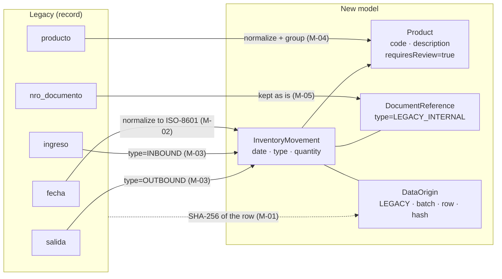
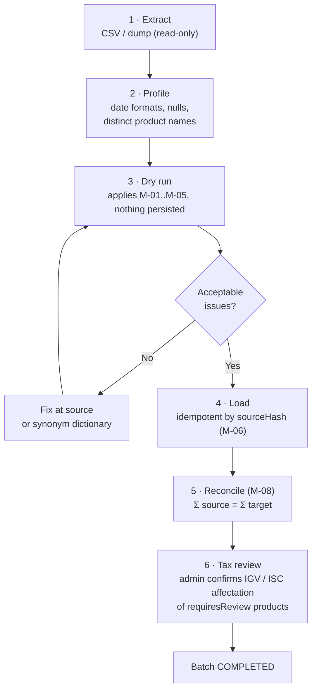

# 06 — Legacy system migration

> Supports the "Legacy and Data Migration" constraint. Formal rules in
> [SPEC-009](../specs/features/009-legacy-migration.md).

## 1. Legacy assessment

The legacy system is a **warehouse control**, not a sales system. Its records contain no price,
customer or taxes, so they **cannot be turned into electronic documents**, and that must not be
attempted: retroactive issuance does not exist. What is migrated with full traceability is the
**movement history** and the **product master**.

## 2. Field-by-field mapping

| Legacy field | Target | Transformation | On failure |
|---|---|---|---|
| `fecha` | `InventoryMovement.date` | Multi-format parsing → `yyyy-mm-dd` | Quarantine (M-02) |
| `ingreso` | `InventoryMovement` type `INBOUND`, `quantity` | Number > 0 | Quarantine (M-03) |
| `salida` | `InventoryMovement` type `OUTBOUND`, `quantity` | Number > 0 | Quarantine (M-03) |
| `producto` | `Product.description` + generated `code`; `InventoryMovement.productCode` | Trim, uppercase, no accents, deduplicate | Quarantine if empty |
| `nro_documento` | `DocumentReference{type: LEGACY_INTERNAL, number}` | None | Empty allowed |
| (whole row) | `DataOrigin{system: LEGACY, migrationBatch, sourceRow, sourceHash}` | SHA-256 | — |

## 3. Process (ETL with audit trail)

## 4. Traceability guarantees (RS 234-2006)

1. **Bidirectional:** from any migrated movement you reach the source row (`sourceRow` +
   `sourceHash`), and from any source row you find its movement(s).
2. **No loss:** every row ends up migrated **or** quarantined with its reason; nothing is silently discarded.
3. **Reconciliation:** control totals per product and overall, stored with the batch.
4. **Immutability:** migrated movements are never edited; they are corrected with an `ADJUSTMENT`.
5. **Untouched source:** the legacy system is not modified and is archived read-only.

## 5. Special cases

| Case | Handling |
|---|---|
| Same product spelled differently ("Cerveza 620ml", "CERVEZA 620 ML") | Normalization + synonym dictionary reviewed by the administrator. |
| Inbound and outbound in the same row | Two movements with the same `sourceHash`. |
| `nro_documento` formatted like `F001-123` | Kept as `LEGACY_INTERNAL`; **not** linked to SUNAT sequence numbers (SPEC-005 R-07). |
| Resulting negative stock | Migrated anyway (it reflects the real history) and reported as a reconciliation issue. |
