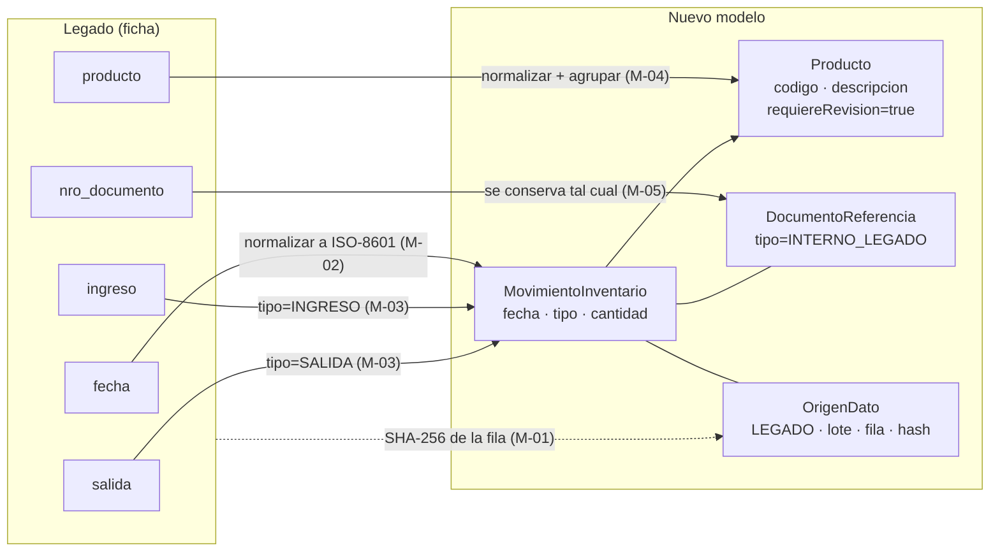
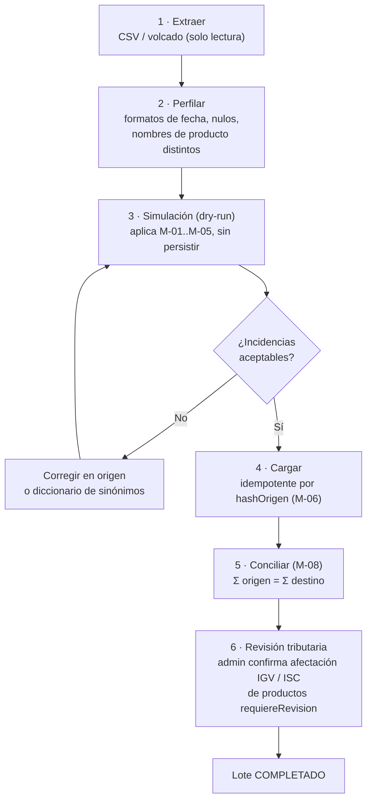

# 06 — Migración del sistema legado

> Soporte de la restricción "Legado y Migración de Datos". Reglas formales en
> [SPEC-009](../specs/features/009-migracion-legado.md).

## 1. Diagnóstico del legado

El legado es un **control de almacén**, no de ventas. Sus fichas no contienen precio, cliente ni
impuestos, por lo que **no se pueden convertir en comprobantes electrónicos**, y tampoco
debe intentarse: no existe la emisión retroactiva. Lo que sí se migra con trazabilidad completa
es el **historial de movimientos** y el **maestro de productos**.

## 2. Mapeo campo a campo

| Campo legado | Destino | Transformación | Si falla |
|---|---|---|---|
| `fecha` | `MovimientoInventario.fecha` | Parseo multi-formato → `aaaa-mm-dd` | Cuarentena (M-02) |
| `ingreso` | `MovimientoInventario` tipo `INGRESO`, `cantidad` | Número > 0 | Cuarentena (M-03) |
| `salida` | `MovimientoInventario` tipo `SALIDA`, `cantidad` | Número > 0 | Cuarentena (M-03) |
| `producto` | `Producto.descripcion` + `codigo` generado; `MovimientoInventario.codigoProducto` | Trim, mayúsculas, sin tildes, deduplicar | Cuarentena si vacío |
| `nro_documento` | `DocumentoReferencia{tipo: INTERNO_LEGADO, numero}` | Ninguna | Se admite vacío |
| (fila completa) | `OrigenDato{sistema: LEGADO, loteMigracion, filaOrigen, hashOrigen}` | SHA-256 | — |

## 3. Proceso (ETL con auditoría)

## 4. Garantías de trazabilidad (RS 234-2006)

1. **Bidireccional:** desde cualquier movimiento migrado se llega a la fila origen (`filaOrigen`
   + `hashOrigen`), y desde cualquier fila origen se encuentra su(s) movimiento(s).
2. **Sin pérdida:** toda fila termina migrada **o** en cuarentena con su motivo; nunca se descarta en silencio.
3. **Conciliación:** totales de control por producto y globales, guardados con el lote.
4. **Inmutabilidad:** los movimientos migrados no se editan; se corrigen con `AJUSTE`.
5. **Origen intacto:** el sistema legado no se modifica y se archiva en modo solo lectura.

## 5. Casos especiales

| Caso | Tratamiento |
|---|---|
| Mismo producto escrito distinto ("Cerveza 620ml", "CERVEZA 620 ML") | Normalización + diccionario de sinónimos revisado por el administrador. |
| Ingreso y salida en la misma fila | Dos movimientos con el mismo `hashOrigen`. |
| `nro_documento` con formato tipo `F001-123` | Se conserva como `INTERNO_LEGADO`; **no** se vincula a correlativos SUNAT (SPEC-005 R-07). |
| Stock resultante negativo | Se migra igual (refleja la historia real) y se reporta como incidencia de conciliación. |
